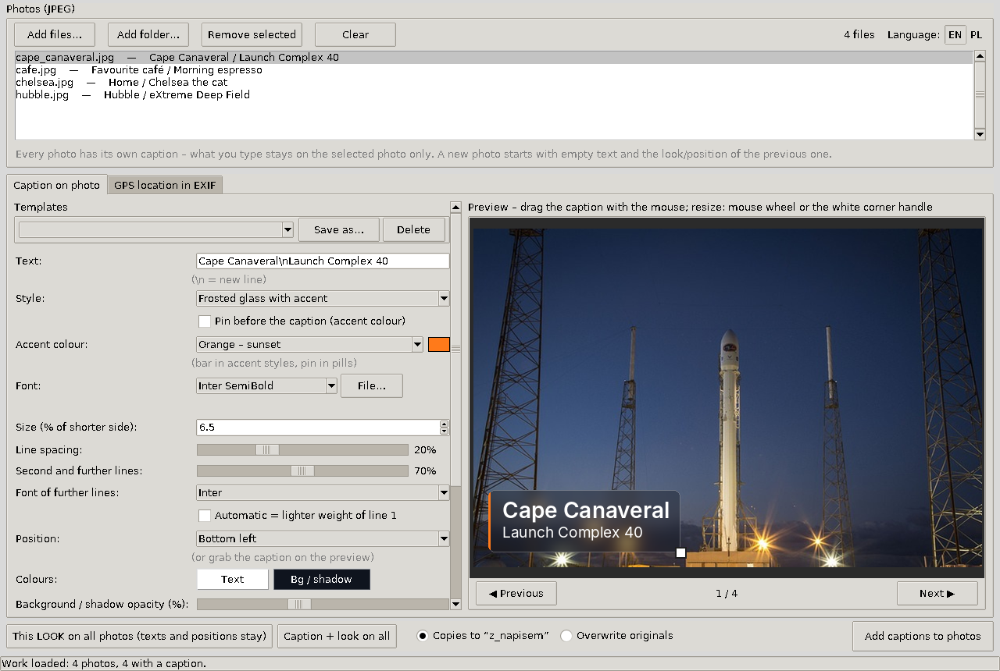
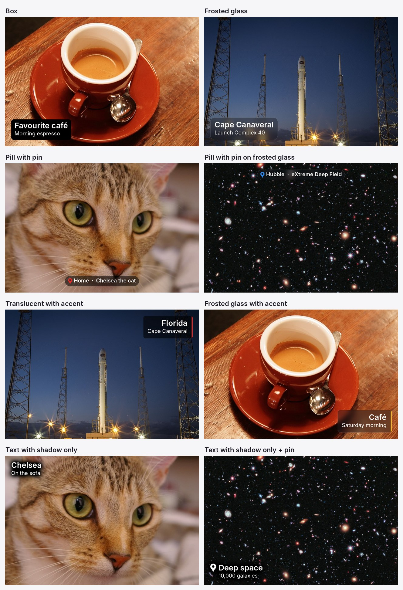

<p align="center">
  
</p>

<h1 align="center">PhotoStamp</h1>

<p align="center">
  Nice-looking place captions burned into your photos – e.g. for a digital photo frame on a tablet.<br><br>
  🇬🇧 <b>English</b> &nbsp;|&nbsp; 🇵🇱 <a href="README.pl.md">Polski</a>
</p>

<p align="center"></p>

## Why

Photo frame apps for Android (such as Fotoo) can show where a photo was taken, but only the place name they work out from GPS themselves. You cannot make them say “My Favorite Restaurant” or “Gdańsk · Polsat Plus Arena”.

PhotoStamp writes that text **directly onto the photo**, so it looks the same in every frame app, gallery and screen.

## Features

- **English and Polish interface**: the **EN / PL** switch in the top-right corner works instantly and is remembered. The first launch is in English.
- **A separate caption for every photo**: text, position, size and look are remembered per photo.
- **Styles**: box, frosted glass (a blurred piece of the photo behind the text), pill with pin, translucent background with a coloured accent bar, frosted glass with accent, and text only with an adjustable shadow.
- **Accent colours from a theme list** (locomotive red, sunset, sea, forest…) or your own colour.
- **Two-line hierarchy**: the second line can be smaller, in a different font or in a lighter weight. All fonts installed on the system are available.
- **Mouse editing on the preview**: drag the caption, resize it with the mouse wheel or the corner handle, with snapping to the edges and centre.
- **Templates**: save a look (e.g. “Greece Corfu”) and apply it to other photos.
- **“This look on all photos”**: restyle a whole series without touching the captions and positions.
- **Autosave**: close the app, open it again, and everything comes back.
- **Originals stay safe**: by default copies go to a `z_napisem` subfolder. The EXIF capture date and GPS are kept, and phone photos keep the right orientation.
- **Extra GPS tab**: write coordinates to EXIF (place search via OpenStreetMap), for frames that show the location themselves.

<p align="center"></p>

## Download

Get the ready-made `PhotoStamp.exe` (Windows 10/11, no installation) from **[Releases](https://github.com/nyorbee/PhotoStamp/releases)**.

The first launch takes a moment longer, because the program unpacks itself to `%LOCALAPPDATA%\nyorbee\PhotoStamp\<version>`. Later launches are fast.

Windows SmartScreen may warn about an unknown publisher, because the file is not code-signed. Click *More info*, then *Run anyway*. The SHA256 checksum of every release is listed in its description.

## How to use

1. **Add files…** or **Add folder…** (JPEG files are supported).
2. Select a photo in the list and type the caption. `\n` starts a new line, e.g. `Gdańsk\nPolsat Plus Arena`.
3. Pick a **style** and an **accent colour**, then drag the caption into place with the mouse. Resize it with the mouse wheel or the white corner handle.
4. Go to the next photo (**Next ▶**). The text field is empty and the look carries over from the previous photo.
5. **Add captions to photos**: the finished files go to `z_napisem` next to the originals.

Tips for tablet photo frames:
- Keep a **4–5% margin**. A frame that fills a 16:9 screen with a 4:3 photo crops the top and bottom.
- Turn off the frame app’s own EXIF location display, so it does not duplicate your caption.

### Where the app keeps its data

In your user folder (`C:\Users\<you>\`):

| File | Contents |
|---|---|
| `.exif_lokalizacja_praca.json` | current work: the photo list plus every photo’s caption and settings |
| `.exif_lokalizacja_szablony.json` | saved templates |
| `.exif_lokalizacja.json` | last used settings and the chosen language |

The app sends nothing over the network. The only exception is the place search in the GPS tab, which queries OpenStreetMap (Nominatim).

## Running from source

Python 3.10 or newer is required (tested on 3.14).

```
pip install -r requirements.txt
python photostamp.py
```


## License

[MIT](LICENSE) © 2026 nyorbee. Components bundled in the exe are listed in [THIRD_PARTY_NOTICES.md](THIRD_PARTY_NOTICES.md).
