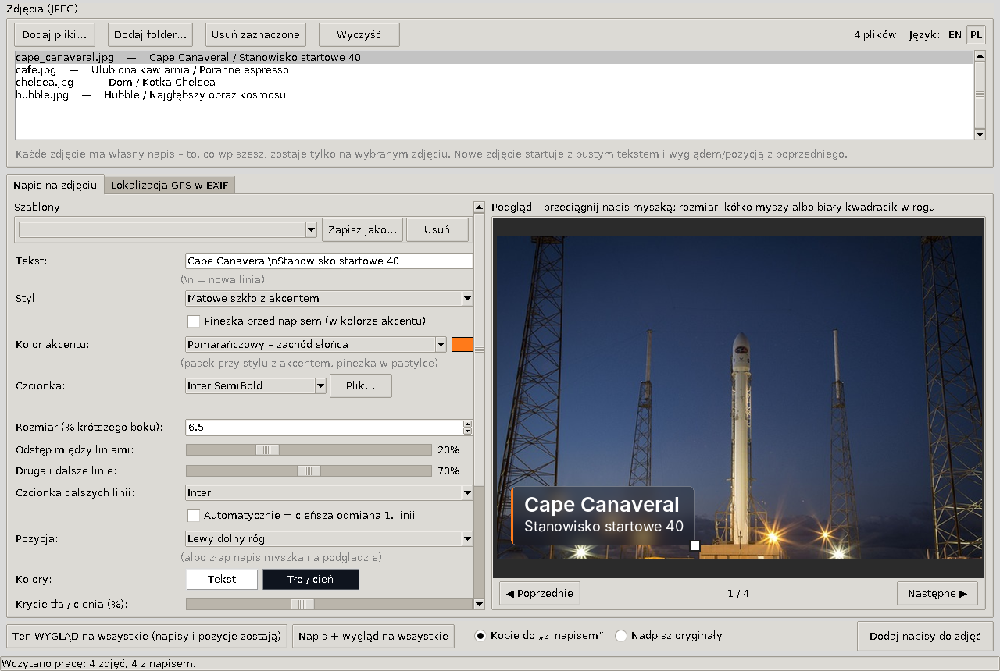
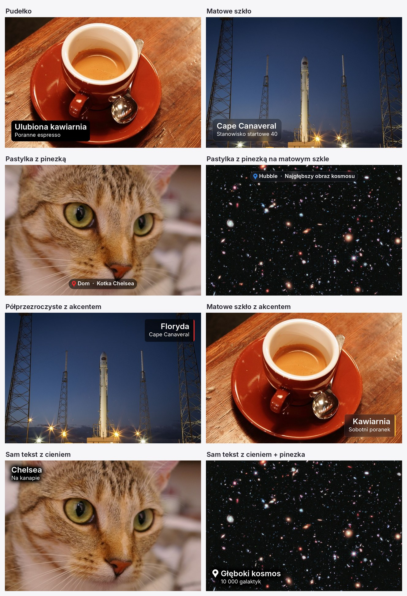

<p align="center">
  
</p>

<h1 align="center">PhotoStamp</h1>

<p align="center">
  Ładne napisy z miejscem wtopione w zdjęcia – np. do cyfrowej ramki na tablecie.<br><br>
  🇬🇧 <a href="README.md">English</a> &nbsp;|&nbsp; 🇵🇱 <b>Polski</b>
</p>

<p align="center"></p>

## Po co to jest

Aplikacje-ramki na Androida (np. Fotoo) potrafią pokazać lokalizację zdjęcia, ale tylko tę, którą same wyliczą z GPS. Nie wpiszesz tam „Moja ulubiona Restauracja” ani „Gdańsk · Polsat Plus Arena”.

PhotoStamp dopisuje taki tekst **bezpośrednio na zdjęciu**, więc wygląda tak samo w każdej ramce, galerii i na każdym ekranie.

## Co potrafi

- **Interfejs po angielsku i po polsku**: przełącznik **EN / PL** w prawym górnym rogu działa od razu i jest zapamiętywany. Przy pierwszym uruchomieniu program startuje po angielsku.
- **Osobny napis na każdym zdjęciu**: tekst, pozycja, rozmiar i wygląd zapamiętywane są dla każdego zdjęcia z osobna.
- **Style**: pudełko, matowe szkło (rozmyty fragment zdjęcia pod napisem), pastylka z pinezką, półprzezroczyste tło z kolorowym akcentem, matowe szkło z akcentem, sam tekst z regulowanym cieniem.
- **Kolory akcentu z listy motywów** (lokomotywa, zachód słońca, morze, las…) albo własny kolor.
- **Dwie linie w hierarchii**: druga linia mniejsza, w innej czcionce albo cieńszej odmianie. Dostępne są wszystkie czcionki zainstalowane w systemie.
- **Myszką na podglądzie**: przeciąganie napisu, zmiana rozmiaru kółkiem albo uchwytem w rogu, przyciąganie do krawędzi i środka.
- **Szablony**: zapisz wygląd (np. „Grecja Korfu”) i nakładaj go na kolejne zdjęcia.
- **„Ten wygląd na wszystkie”**: zmiana stylu całej serii bez ruszania napisów i pozycji.
- **Autozapis pracy**: po zamknięciu i ponownym otwarciu wszystko wraca.
- **Bezpiecznie dla oryginałów**: domyślnie zapisuje kopie do podfolderu `z_napisem`. Data zrobienia zdjęcia i GPS w EXIF zostają, zdjęcia z telefonu są poprawnie obrócone.
- **Dodatkowo, zakładka GPS**: wpisanie współrzędnych do EXIF (wyszukiwanie miejsca przez OpenStreetMap), dla ramek, które same pokazują lokalizację.

<p align="center"></p>

## Pobieranie

Gotowy `PhotoStamp.exe` (Windows 10/11, bez instalacji) znajdziesz w zakładce **[Releases](https://github.com/nyorbee/PhotoStamp/releases)**.

Pierwsze uruchomienie trwa chwilę dłużej, bo program rozpakowuje się do `%LOCALAPPDATA%\nyorbee\PhotoStamp\<wersja>`. Kolejne starty są szybkie.

Windows SmartScreen może ostrzec przed nieznanym wydawcą, bo plik nie jest podpisany certyfikatem. Kliknij „Więcej informacji”, a potem „Uruchom mimo to”. Suma SHA256 każdego wydania jest podana w jego opisie.

## Jak używać

1. **Dodaj pliki…** albo **Dodaj folder…** (obsługiwane są pliki JPEG).
2. Wybierz zdjęcie z listy i wpisz tekst. `\n` robi nową linię, np. `Gdańsk\nPolsat Plus Arena`.
3. Wybierz **styl** i **kolor akcentu**, a napis przeciągnij myszką w wybrane miejsce. Kółkiem myszy albo białym kwadracikiem zmienisz rozmiar.
4. Przejdź do kolejnego zdjęcia (**Następne ▶**). Pole tekstu jest puste, a wygląd przechodzi z poprzedniego.
5. **Dodaj napisy do zdjęć**: gotowe pliki trafiają do `z_napisem` obok oryginałów.

Wskazówki do ramek na tabletach:
- Zostaw **margines 4–5%**. Ramka wypełniająca ekran 16:9 zdjęciem 4:3 obcina górę i dół.
- Na ramce wyłącz wyświetlanie lokalizacji z EXIF, żeby nie dublowała napisu.

### Gdzie program trzyma dane

W folderze użytkownika (`C:\Users\<Ty>\`):

| Plik | Zawartość |
|---|---|
| `.exif_lokalizacja_praca.json` | bieżąca praca: lista zdjęć oraz napisy i ustawienia każdego z nich |
| `.exif_lokalizacja_szablony.json` | zapisane szablony |
| `.exif_lokalizacja.json` | ostatnio używane ustawienia i wybrany język |

Program niczego nie wysyła w sieć. Jedyny wyjątek to wyszukiwanie miejsca w zakładce GPS, które łączy się z OpenStreetMap (Nominatim).

## Uruchamianie ze źródeł

Wymagany jest Python 3.10 lub nowszy (testowane na 3.14).

```
pip install -r requirements.txt
python photostamp.py
```


## Licencja

[MIT](LICENSE) © 2026 nyorbee. Biblioteki zawarte w exe są opisane w [THIRD_PARTY_NOTICES.md](THIRD_PARTY_NOTICES.md).
